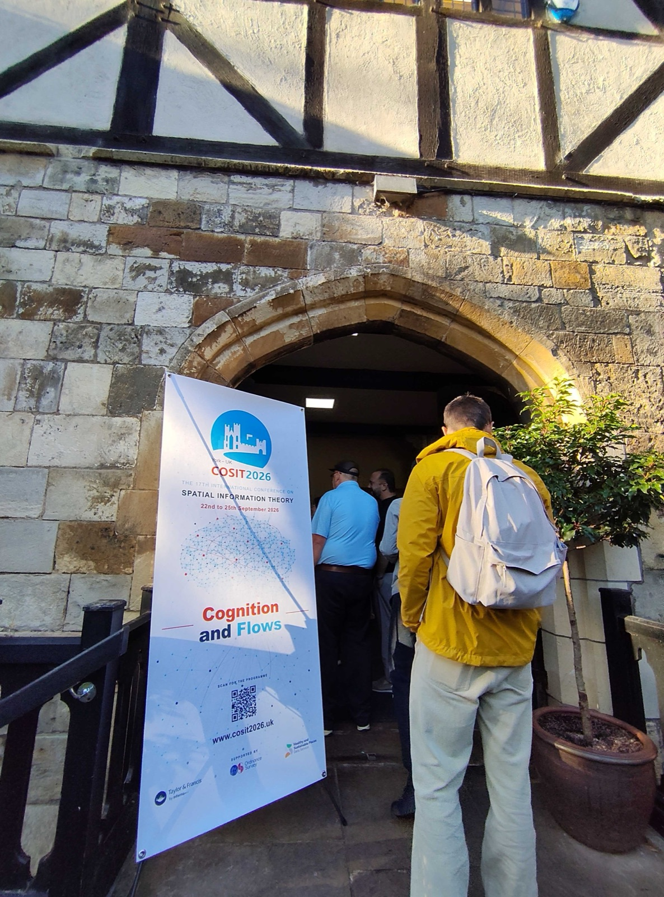
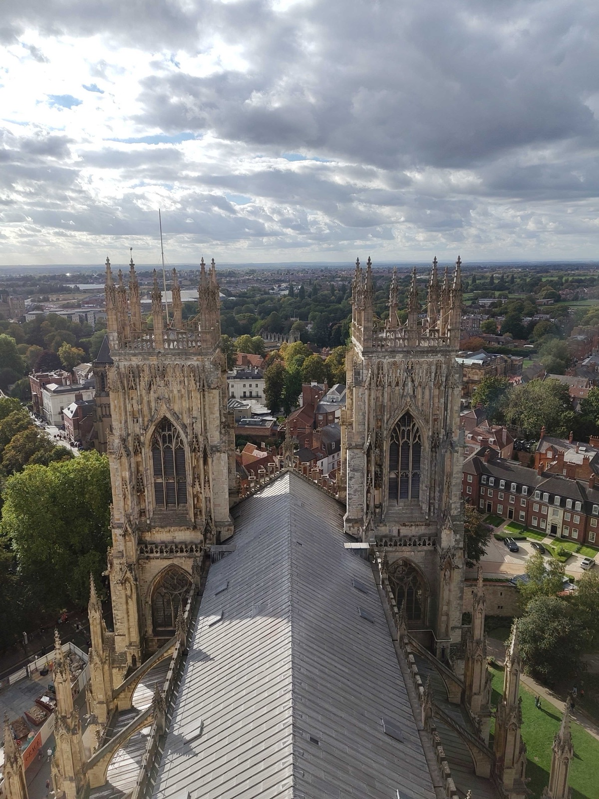
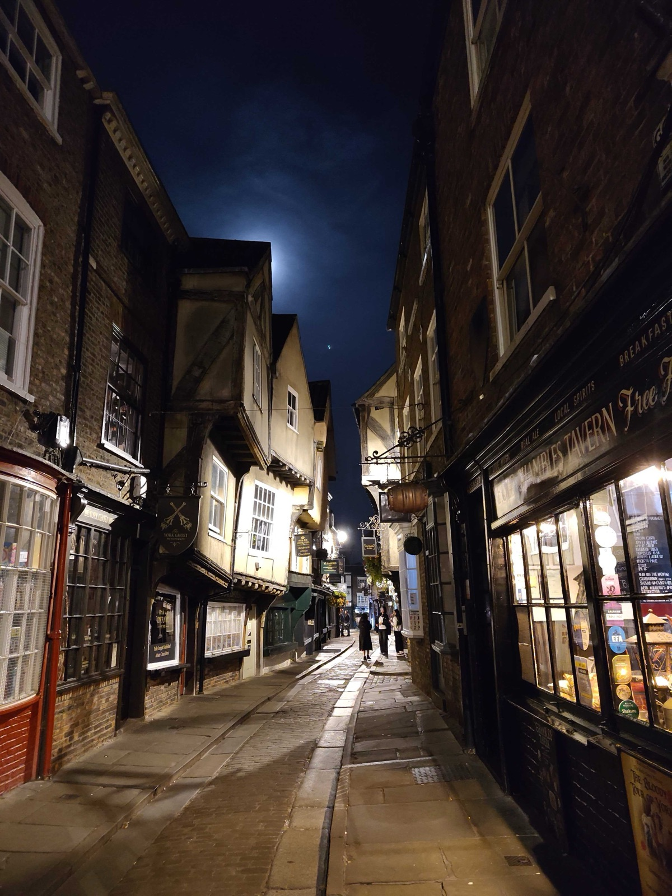

From 22 to 25 September 2026, [Kai Moltzen](/team/kai-moltzen/) attended the 17th **Conference on Spatial Information Theory (COSIT 2026)** in York, UK. The biennial, interdisciplinary conference brings together researchers working on space, place and spatial information.

## Our contributions

- **[GeoKG for GeoFM: Neuro-Symbolic Integration of Semantically-Enriched Geospatial-Temporal Data](/publications/geokg-for-geofm-neurosymbolic-integration-of-semanticallyenriched-geospatialtemporal-data-short-pape/)**: our vision paper, presented in the *Language and Foundation Models* session ([DOI](https://doi.org/10.4230/LIPIcs.COSIT.2026.20)).
- **Semantic Earth Embeddings for Disaster Resilience**: Kai's research proposal, presented in the *Doctoral Mentoring Programme* ([DOI](https://doi.org/10.5281/zenodo.22831723)).

Both presentations received very positive feedback and led to lively discussions, which we hope will turn into follow-up work and collaborations.

## A welcoming community

Throughout the conference, the COSIT community showed how much it values critical but respectful discussion and close exchange: many questions after the talks, plenty of room for conversations, and well-organised social events. The three keynote speakers, Krzysztof Janowicz, Laura Alessandretti and Hugo Spiers, presented their research agendas on GeoAI, modelling human dynamics, and cognitive representations of the world.

Thanks to the organisers and everyone who made COSIT 2026 such an open and stimulating event. We hope to present our research there again in two years. Ideas, questions or comments on our work? [Get in touch with Kai](/team/kai-moltzen/).

  
  

